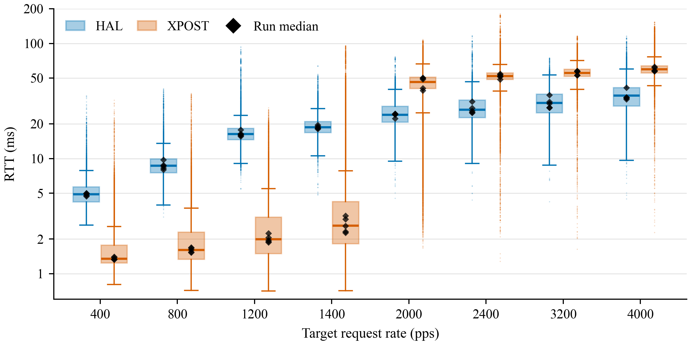
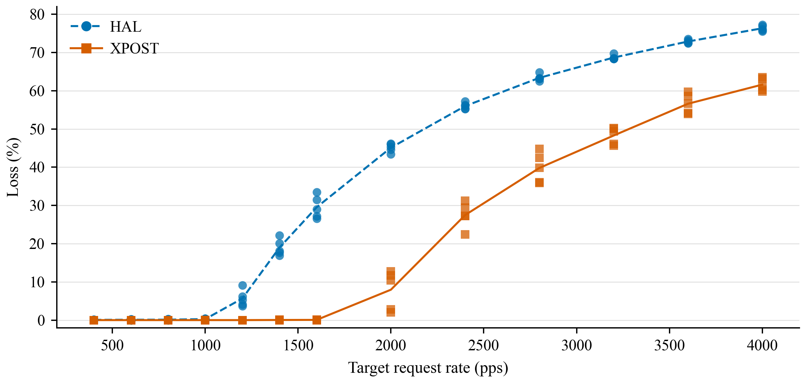
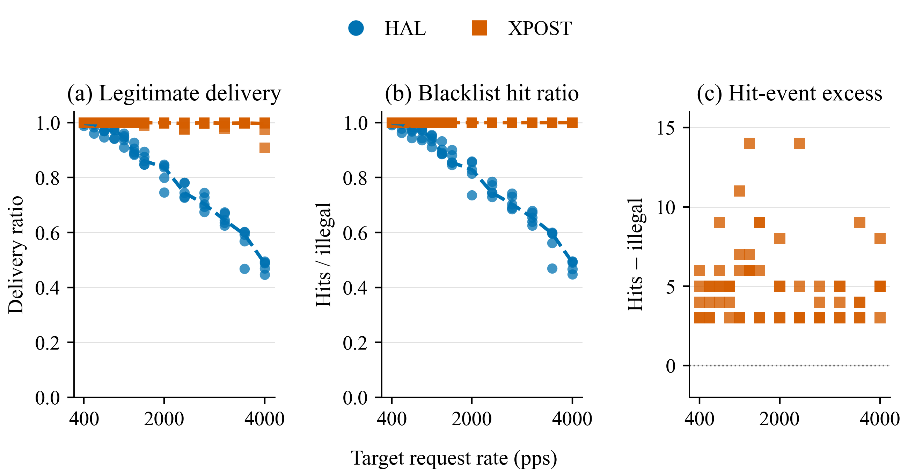
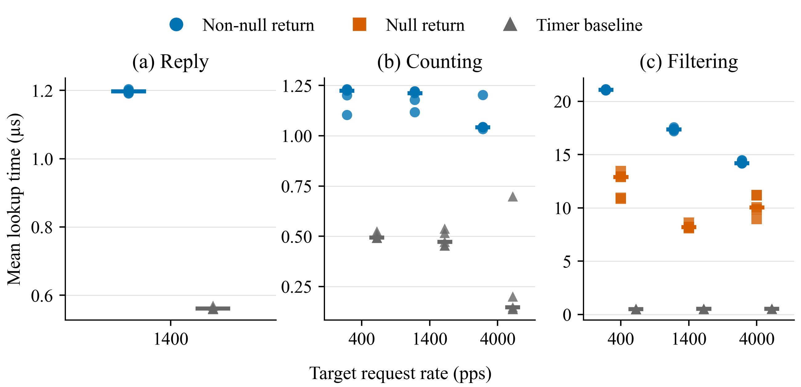
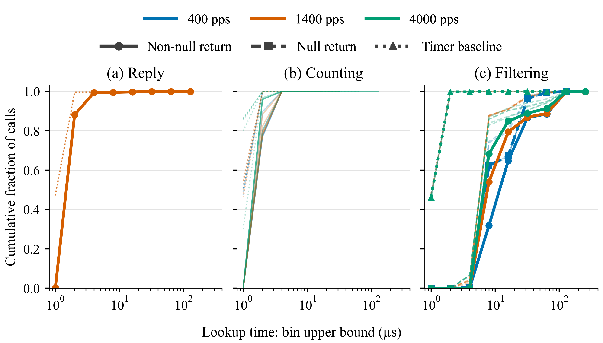

# xpost

xpost is an XDP runtime for bare-metal MCU firmware, with board examples and host tools. Firmware uses Rust `core` and the esp-rs bare-metal stack. It does not use ESP-IDF. The implemented target is the ESP32-C3. The ISA is RV32IMC, the ABI is `ilp32`, and there is no FPU.

libbpf-mcu compiles one C source into an eBPF object and an RV32IMC XDP ELF. The image installed on the board is the RV32IMC image for ahead-of-time execution, or the eBPF object packed into the same container for the interpreter. The runtime calls the entry at the absolute address in the linker script. It does not parse a firmware ELF on the device, and it does not apply dynamic relocations.

The evaluation figures under Experiments are copied from the paper draft. That draft is not in this repository.

Code in this repository uses the [MIT](LICENSE) license. `esp-radio/` keeps the upstream MIT OR Apache-2.0 license.

## Status

The tree is still changing. This publication keeps the lab configuration in place. `xpost-test/rust-toolchain.toml` contains a machine-local absolute path. `xpost-test/config/default.toml` contains lab addresses and database settings. Scripts use the SSH host name `tr3000`. Running the tests on another machine means reading those files and editing them. The build steps below are the commands used on the current machine.

## Files

Keep the three build products distinct.

The firmware ELF is the board application. Its usual path is `examples/<app>/target/riscv32imc-unknown-none-elf/release/<app>`. XDP firmware includes `XdpRt`. HAL firmware does not include this runtime.

The XDP ELF, also written `xdp.elf`, is the cold-region container. It has `.xpost.meta` and `.xpost.image`. `<stem>` is the program name, such as `just_tx`. libbpf-mcu writes it to `../build/<stem>/<stem>.elf`. Cold installation writes that file into the firmware's `xdp` flash partition. The firmware ELF and the XDP ELF are programmed separately.

`esp32c3.elf` is the libbpf-mcu ahead-of-time debug ELF. Its usual path is `../build/<stem>/esp32c3.elf`. Do not use it for cold installation.

## Toolchain

`rust-toolchain.toml` selects nightly and includes the `riscv32imc-unknown-none-elf` target. The root package sets `rust-version` to 1.88.

The root Cargo workspace contains the root package, `esp-radio`, `xpost-macros`, `xpost-elf`, `xpost-perf`, `xpost-type`, and `rbpf`. `xpost-build`, `xpost-agent`, `xpost-serial`, `xpost-test`, and `examples/` each have their own workspace.

`rbpf` is the in-tree eBPF interpreter. The `mcu` feature builds it without a global allocator and without a JIT.

## Engines

`examples/exec_bench_hal` runs the eight workloads as native Rust. It does not link the xpost runtime.

`examples/exec_bench` runs an XDP image through `exec_call` and does not start Wi-Fi. A build without `interp` executes the RV32IMC machine code in the XDP ELF. A build with `--features interp` executes the eBPF object through `rbpf`. `diag` is a Cargo feature. It turns on the scale sweep in the exec_bench figure under Experiments.

On `exec_bench`, the hot slot and the cold-table cell are 8 KiB, and the XDP ELF encoder accepts a container up to 8 KiB. That is what lets the `bsort` bytecode image be staged. Other examples still declare the smaller slot in their own manifests.

## Build firmware

Build from the example directory. A network example also needs `WIFI_SSID` and `WIFI_PASS` in that directory's `.env`. `WIFI_PASSWORD` is an alias for `WIFI_PASS`.

```bash
cargo build --release --features perf-cag
```

The command above is for `examples/just_xdp`. `perf-cag` enables the counter, the aggregate, and the gauge. `perf-t` enables the counter and trace. There is no default feature. Build `xpost-test` in `xpost-test/` and run that binary. It reads `run` from `xpost-test/config/default.toml` and calls the agent to flash.

The HAL network examples are `examples/just_tx_hal`, `examples/just_drop_hal`, and `examples/firewall_hal`.

## Host agent

`xpost-agent` owns the USB serial port. It serves HTTP `/health`, `/v1/*`, and MCP `/mcp` on one port. Startup only opens the USB session. `xpost-test` later asks the agent, over HTTP, to flash a firmware ELF or an XDP ELF.

Run the command from `xpost-agent/`.

```bash
cargo run --release -- --bind 127.0.0.1:9240
```

## Layout

```text
src/             runtime: maps, helpers, slots, RX, optional exec-call
esp-radio/       local radio driver and XDP ingress
rbpf/            eBPF interpreter used by the interp engine
xpost-type/      shared XDP actions and traits
xpost-elf/       XDP ELF codec and the XPM1 memory-map contract
xpost-macros/    map derives and flash_layout!
xpost-perf/      shared sweep sizes and the versioned perf report
examples/        board firmware, one Cargo workspace each
xpost-serial/    serial protocol library
xpost-agent/     host daemon
xpost-build/     xpost-link and the XDP ELF packer
xpost-test/      host experiment runner
```

The current code uses `xpost-type`. `xpost-trait/` is an older interface. Workspace members do not reference it.

## Experiments

`xpost-test` runs the names in the `run` key of `xpost-test/config/default.toml`. HAL is native Rust on the same ESP32-C3 and does not link this runtime. XPOST is the ahead-of-time RV32IMC image loaded into that runtime. On the three network experiments, each point is one 30 second run. The horizontal axis is the target send rate, from 400 to 4000 packets per second. Those figures are copied from the paper and compare HAL with XPOST only.

TODO: fix the abnormal shapes in `just_tx` and `firewall`, and add an rbpf control group beside HAL and XPOST on all three network experiments, including the lookup panels. In `just_tx`, the XPOST round-trip time stays below HAL and then jumps above it after 1400 packets per second. In `firewall`, HAL delivery and hit ratio fall as the rate rises, while XPOST stays near 1. `just_drop` has no separate rate plot. Its result is the Counting panel, and that panel also lacks the rbpf series.

### just_tx

The host sends one UDP packet per request. The program exchanges the Ethernet source and destination, exchanges the IP source and destination, and transmits the packet back. The first figure is that round-trip time in milliseconds. The second is the percentage of requests with no matching reply. The program also counts packets in array map `rxcnt`, keyed by IP protocol. That lookup is the Reply panel below.

`xpost-test/common/src/exam/just_tx.rs` drives the host. The board firmware is `examples/just_xdp`, and the image it loads is `../build/just_tx/just_tx.elf`. The HAL firmware is `examples/just_tx_hal`.





### just_drop

The host sends UDP packets whose IPv4 source addresses differ in the last byte. The program uses that byte as the key of array map `counter`, adds one to the stored count, and drops the packet. It sends nothing back. There is no HAL-versus-XPOST plot against send rate for this experiment. The published result is how long that map lookup takes while the counting runs. That is panel (b) Counting in the lookup figures below.

`xpost-test/common/src/exam/just_drop.rs` drives the host. The board firmware is `examples/just_xdp`, and the image it loads is `../build/just_drop/just_drop.elf`. The HAL firmware is `examples/just_drop_hal`.

### firewall

The program keeps a hash map of 200 blocked IPv4 addresses. In each 30 second window, one packet in ten uses a source address outside that map and should pass. The other nine should be dropped, and a drop adds one to the matching key. The host counts a legal packet as delivered when it observes that packet's token come back from the board. Panel (a) is those deliveries divided by legal packets sent. A hit is one increment of a blacklist key. Panel (b) is the sum of those increments divided by illegal packets sent. Panel (c) is that sum minus the number of illegal packets sent.

`xpost-test/common/src/exam/firewall.rs` drives the host. The XPOST firmware is `examples/firewall`. The HAL firmware is `examples/firewall_hal`.



### Map lookup

These two figures are the map lookups taken during the three network runs, not a fourth experiment. Reply is `just_tx`, Counting is `just_drop`, and Filtering is `firewall`. The three series on each panel are a non-null return, a null return, and the timer baseline. They are not HAL, XPOST, and rbpf. A non-null return found a map entry. A null return did not. The timer baseline is the clock cost with no map operation. The mean figure's vertical axis is the average of that series in microseconds, and its horizontal axis is the same target send rate. The distribution figure draws each series at 400, 1400, and 4000 packets per second as its own cumulative curve. Its horizontal axis is the upper edge of each time bin, in microseconds, and its vertical axis is the fraction of lookups in that series at or below that edge.





### exec_bench

Eight programs run as a function call, with no Wi-Fi. `incr` adds one to a word. `square` squares a word. `bitswap` reverses the bits of a word. `fib` loops. `buf` and `memcpy` copy bytes. `fletcher32` checksums bytes. `bsort` sorts up to six 32-bit words. The input's work-size field is the horizontal axis. `incr`, `square`, and `bitswap` ignore it and do a fixed amount of work, so their lines are flat. `fib` loops that many times, up to 47. `buf` copies that many bytes, up to 1024. `memcpy` copies at most 12 bytes, `fletcher32` checksums at most 20 bytes, and `bsort` sorts at most six words. For `fib` and `buf`, the horizontal axis is logarithmic with base 2. The vertical axis is microseconds for one call, from the board's microsecond clock. The line is a straight fit of time against the work size itself. On the logarithmic axis that line is not straight. The band is the 99% confidence interval of the fit.

HAL is `examples/exec_bench_hal`. AOT is `examples/exec_bench` running the RV32IMC image. Interpreter is that same example built with `--features interp`, which runs the eBPF object in `rbpf`. `bsort`'s eBPF object is larger than 4 KiB, so this example's hot slot, cold-table cell, and XDP ELF encoder all accept 8 KiB. Other examples keep the smaller slot declared in their own manifests.

`xpost-test/common/src/exam/exec_bench.rs` is the host check for these workloads.


### case and hot_swap

`case` loads two images into `examples/case_xdp`, one at a time. For the active image the host sends four UDP packets, `CASE0` through `CASE3`, and checks the board's transmit on a packet capture. `case_swap` is correct when the Ethernet addresses are exchanged, the IPv4 destination is `203.0.113.10`, and the payload is unchanged. `case_mark` is correct when the Ethernet addresses are exchanged, the IPv4 destination is `203.0.113.77`, and the payload is unchanged. `hot_swap` then switches between the two images. The image being left stays staged, so the switch does not copy it again.

Each point on the figure is one stage. Its value is the number of milliseconds from the first command until the agent's reply for that stage. Cold replace stops the old image, overwrites the slot, and enables the new one. Hot switch only publishes an image that is already staged. The dashed segment crosses the stop and overwrite stages, which the hot path does not run.

`xpost-test/common/src/exam/case.rs` and `xpost-test/common/src/exam/hot_swap.rs` drive the host.


