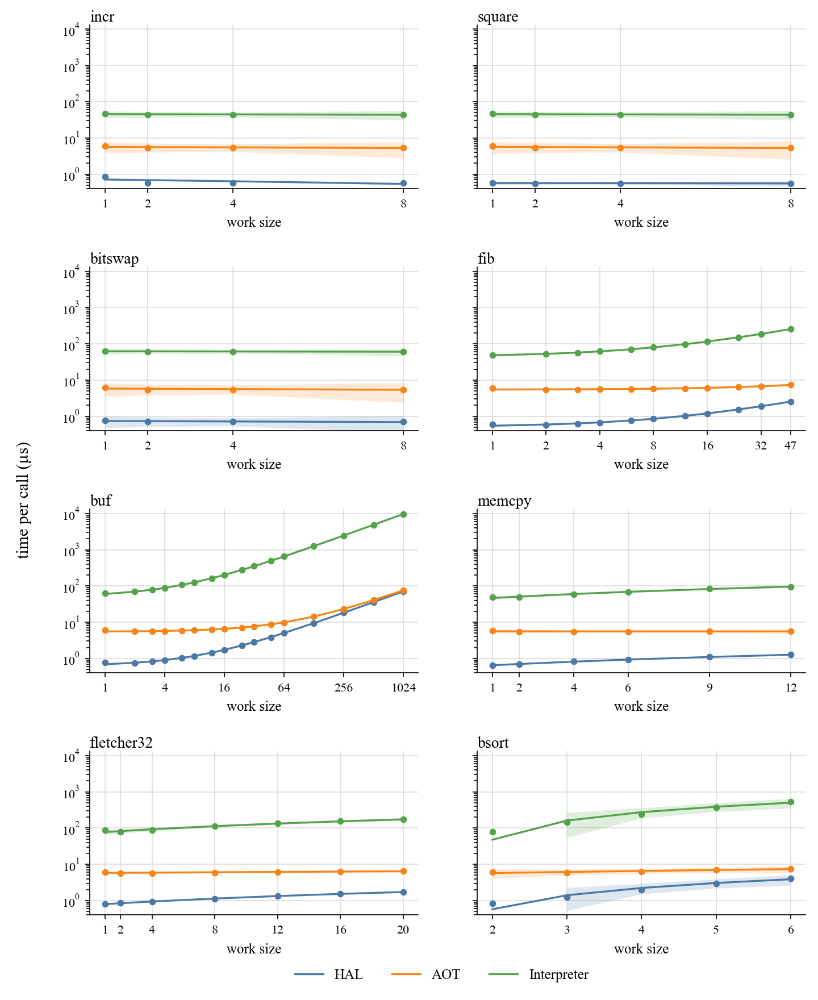
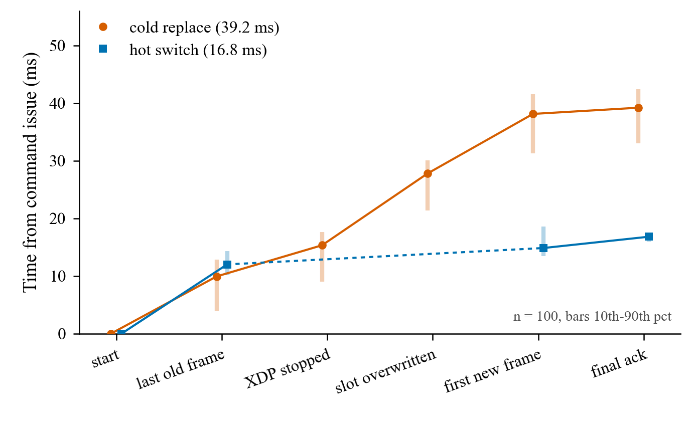

# xpost

xpost is an XDP runtime for bare-metal MCU firmware, with board examples and host tools. Firmware uses Rust `core` and the esp-rs bare-metal stack. It does not use ESP-IDF. The implemented target is the ESP32-C3. The ISA is RV32IMC, the ABI is `ilp32`, and there is no FPU.

libbpf-mcu compiles one C source into an eBPF object and an RV32IMC XDP ELF. The image installed on the board is the RV32IMC image for ahead-of-time execution, or the eBPF object packed into the same container for the interpreter. The runtime calls the entry at the absolute address in the linker script. It does not parse a firmware ELF on the device, and it does not apply dynamic relocations.

The paper is not in this repository.

Code in this repository uses the [MIT](LICENSE) license. `esp-radio/` keeps the upstream MIT OR Apache-2.0 license.

## Status

The tree is still changing. This publication keeps the lab configuration in place. `xpost-test/rust-toolchain.toml` contains a machine-local absolute path. `xpost-test/config/default.toml` contains lab addresses and database settings. Scripts use the SSH host name `tr3000`. Running the tests on another machine means reading those files and editing them. The build steps below are the commands used on the current machine.

## Files

Keep the three build products distinct.

The firmware ELF is the board application. Its usual path is `examples/<app>/target/riscv32imc-unknown-none-elf/release/<app>`. XDP firmware includes `XdpRt`. HAL firmware does not include this runtime.

The XDP ELF, also written `xdp.elf`, is the cold-region container. It has `.xpost.meta` and `.xpost.image`. Its usual path is `../build/<stem>/<stem>.elf`. Cold installation uses this file.

`esp32c3.elf` is the libbpf-mcu ahead-of-time debug ELF. Its usual path is `../build/<stem>/esp32c3.elf`. Do not use it for cold installation.

## Toolchain

`rust-toolchain.toml` selects nightly and includes the `riscv32imc-unknown-none-elf` target. The root package sets `rust-version` to 1.88.

The root Cargo workspace contains the root package, `esp-radio`, `xpost-macros`, `xpost-elf`, `xpost-perf`, `xpost-type`, and `rbpf`. `xpost-build`, `xpost-agent`, `xpost-serial`, `xpost-test`, and `examples/` each have their own workspace.

`rbpf` is the in-tree eBPF interpreter. The `mcu` feature builds it without a global allocator and without a JIT.

## Engines

`examples/exec_bench_hal` runs the eight workloads as native Rust. It does not link the xpost runtime.

`examples/exec_bench` runs an XDP image through `exec_call` and does not start Wi-Fi. A build without `interp` executes the RV32IMC machine code in the XDP ELF. A build with `--features interp` executes the eBPF object through `rbpf`. `diag` turns on the scale sweep used for the figure below.

On `exec_bench`, the hot slot and the cold-table cell are 8 KiB, and the XDP ELF encoder accepts a container up to 8 KiB. That is what lets the `bsort` bytecode image be staged. Other examples still declare the smaller slot in their own manifests.

## Build firmware

Build from the example directory. A network example also needs `WIFI_SSID` and `WIFI_PASS` in that directory's `.env`. `WIFI_PASSWORD` is an alias for `WIFI_PASS`.

```bash
cargo build --release --features perf-cag
```

The command above is for `examples/just_xdp`. `perf-cag` enables the counter, the aggregate, and the gauge. `perf-t` enables the counter and trace. There is no default feature.

The HAL network examples are `examples/just_tx_hal`, `examples/just_drop_hal`, and `examples/firewall_hal`.

## Host agent

`xpost-agent` owns the USB serial port. It serves HTTP `/health`, `/v1/*`, and MCP `/mcp` on one port. Startup only opens the USB session. Flashing and application changes happen when a request arrives.

Run the command from `xpost-agent/`.

```bash
cargo run --release -- --bind 127.0.0.1:9240
```

## Layout

```text
src/             runtime: maps, helpers, slots, RX, optional exec-call
esp-radio/       local radio driver and XDP ingress
rbpf/            eBPF interpreter used by the interp engine
xpost-type/      shared XDP actions and traits
xpost-elf/       XDP ELF codec and the XPM1 memory-map contract
xpost-macros/    map derives and flash_layout!
xpost-perf/      shared sweep sizes and the versioned perf report
examples/        board firmware, one Cargo workspace each
xpost-serial/    serial protocol library
xpost-agent/     host daemon
xpost-build/     xpost-link and the XDP ELF packer
xpost-test/      host experiment runner
```

The current code uses `xpost-type`. `xpost-trait/` is an older interface. Workspace members do not reference it.

## Measurements

Both figures below were taken on an ESP32-C3.

### Execution time

The eight workloads are `incr`, `square`, `bitswap`, `fib`, `buf`, `memcpy`, `fletcher32`, and `bsort`. `incr`, `square`, and `bitswap` do a fixed operation, and the sweep repeats that operation at several parameter values. `fib` loops for `param` iterations, up to 47. `buf` copies `param` bytes, up to 1024. `memcpy` copies up to 12 bytes, `fletcher32` checksums up to 20 bytes, and `bsort` sorts up to six 32-bit words.

Each point is the mean time of one call. The firmware times 200 calls as one batch on the microsecond clock and divides by 200. Each engine was booted five times. The vertical bars are the standard deviation across those boots. The line is a straight fit of mean time against work size. The band is the 99% confidence interval of that line. The vertical scale is shared. `fib` and `buf` use a log base 2 horizontal axis. The other panels are linear, with ticks at the sizes that were run.

HAL is `exec_bench_hal`. AOT is `exec_bench` running RV32IMC machine code. Interpreter is `exec_bench` built with `interp`.



### Update latency

This figure is a different experiment. It times one XDP image update on the test host clock, in milliseconds from the moment the command was issued. Cold replace stops the running image, overwrites the slot, and enables the new image. Hot switch publishes an image that is already staged, and it skips the stop and overwrite stages. The dashed segment is that skip. The bars are the 10th to 90th percentile of 100 repeats. The device's own microsecond counter is not included, because it starts at boot and shares no epoch with the host clock.


