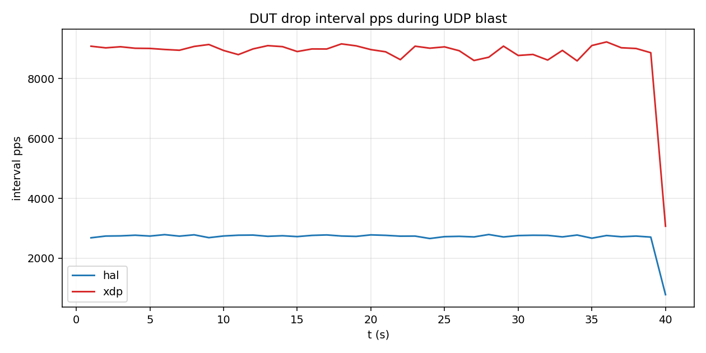
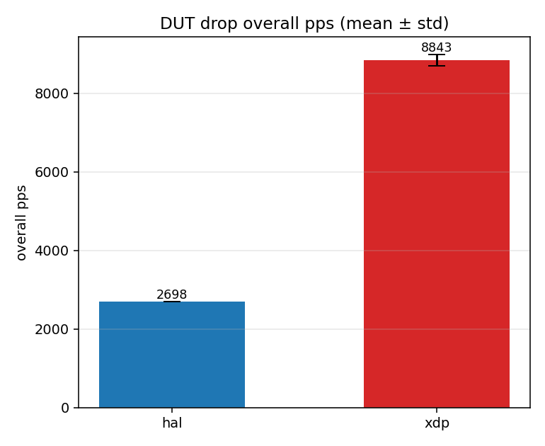

# just_drop vs just_drop_hal PPS 实验记录

方法见 [README.md](README.md)。

## 环境

| 项 | 值 |
|----|-----|
| 日期 | 2026-09-25 |
| Mac agent | `192.168.110.96:9240` |
| ESP | `192.168.110.103` / `dc:1e:d5:e5:e0:c8` |
| TR3000 | `/tmp/probe just-drop-pps`，blast UDP×4 64B → `:8080` |
| 窗口 / 采样 / 轮次 | **40s / 1000ms / 3** |
| HAL 固件 | `examples/just_drop_hal` release + `drop on` |
| XDP 固件 | `examples/just_drop` release + `program just_drop.elf` |

## 结果摘要

权威数字来自 probe 侧 `*_summary.json` 的 `overall_pps`（`dropΔ / blast.elapsed_secs`）：

| path | overall_pps mean | overall_pps std | host_pps（轮次均值约） | dropΔ / 40s（约） |
|------|------------------|-----------------|------------------------|-------------------|
| **hal** | **2740** | **6** | ~9040 | ~1.10×10⁵ |
| **xdp** | **8956** | **146** | ~8950 | ~3.59×10⁵ |

比值：**XDP / HAL ≈ 3.3×**（同刺激、同窗口下 DUT `drop` 吞吐）。

分轮（probe）：

| round | hal overall_pps | xdp overall_pps |
|-------|-----------------|-----------------|
| 1 | 2747 | 9027 |
| 2 | 2737 | 9052 |
| 3 | 2736 | 8788 |

两臂 `net_rxΔ = 0`：HAL 在 `drop on` 下不 ACK 也不增 `net_rx`；XDP ingress 丢包不到栈。

## 图

- 
- 

（柱状图用 CSV 末样点 `overall_pps_so_far` 汇总，与上表差 <2%，以 JSON 为准。）

## 原始数据

- [`results/hal_pps.csv`](results/hal_pps.csv) / [`results/hal_pps_summary.json`](results/hal_pps_summary.json)
- [`results/xdp_pps.csv`](results/xdp_pps.csv) / [`results/xdp_pps_summary.json`](results/xdp_pps_summary.json)
- [`results/summary.json`](results/summary.json)（绘图汇总）

## 解读

- **Host 发送**约 9k pps，接近无线侧可注入上限；XDP 臂 `dut_pps ≈ host_pps`，说明 ingress drop 能跟上 blast。
- **HAL 臂**约 **2.7k pps**，约为 host 的 30%：包已进入 smoltcp/UDP 路径再记 drop，栈与 socket 路径成为瓶颈。
- 区间 pps 标准差相对较大（采样 1s + 计数器读延迟），但整窗 overall 很稳（HAL std≈6；XDP 第三轮略低仍在同量级）。
- 本对比度量的是 **可观测 drop 计数吞吐**，不是同层（ingress vs 应用）的公平微基准。
